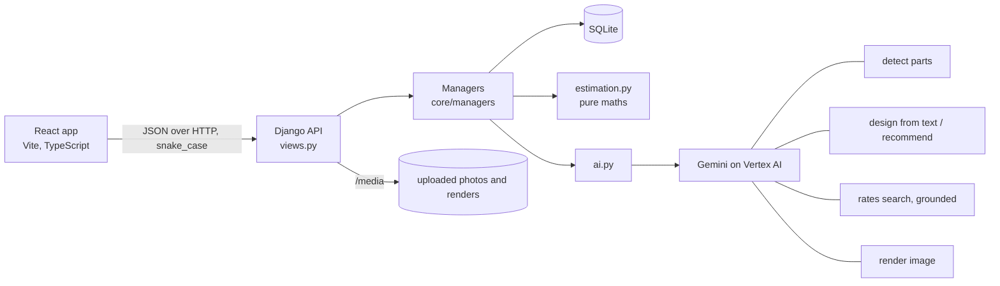

# Architecture

Miesign · Author: Mihir Kapildev Tiwari

## System

## Layering rules

- **Views** (`core/views.py`) parse the request, call one manager, and return a serialized result. No business logic.
- **Managers** (`core/managers/*`) hold business logic and orchestrate. They are the only layer that reads and writes models and the only caller of `ai.py`.
- **Models** (`core/models.py`) are plain data. Every table has a UUID `id`, `created_at`, `updated_at`, and `deleted_at` (soft delete). Relations are indexed UUID columns, not foreign keys.
- **AI service** (`core/ai.py`) is the only module that calls Gemini. It returns plain dicts and bytes and never touches the database. Calls retry once, then raise `AiUnavailable` (HTTP 503).
- **Estimation** (`core/estimation.py`) is pure functions with no I/O. The model never does arithmetic: it only returns boxes, specs and rate numbers; every area, quantity and cost is computed here.
- **Errors** are `AppError(code, message, status)` and always render as `{"error": {"code", "message", "status", "details"}}`.

## Data model

| Model | Purpose | Key fields |
|---|---|---|
| `Project` | One house; the shareable unit (its id is the link) | `name`, `state`, `city`, `px_per_ft`, `scale_source` (`default`/`user`), `primary_photo_id`, `render_count` |
| `Photo` | An uploaded, normalised JPEG | `project_id`, `file`, `width`, `height`, `quality_ok`, `quality_report` (issues, tips) |
| `Component` | A detected or user-drawn part | `project_id`, `photo_id`, `type`, `quad` (4 pixel points), `floor`, `source` (`ai`/`user`), `confidence` |
| `Design` | A material plan and its render | `project_id`, `name`, `mode` (`free_text`/`guided`/`manual`), `input`, `spec`, `rationale`, `warnings`, `render_file`, `render_spec_hash` |
| `RateCache` | Shared city rates | `state`, `city`, `material_id`, `material_rate`, `labor_rate`, `source` (`web`/`estimated`), `sources`, `fetched_at`; unique per state, city, material |
| `RateOverride` | A user's own rate for one project | `project_id`, `material_id`, `material_rate?`, `labor_rate?`; unique per project and material |

## API

All mutations are `POST`; ids are query parameters; bodies and responses are `snake_case` JSON. "project" is the project object (photos, parts, designs, render counts).

| Method | Path | Body | Returns |
|---|---|---|---|
| POST | `/api/project/create` | `{name?}` | project |
| GET | `/api/project?id=` | | project |
| POST | `/api/project/update?id=` | `{name?, state?, city?}` | project |
| POST | `/api/photo/upload?project_id=` | multipart `file` | project |
| POST | `/api/photo/set-primary?project_id=` | `{photo_id}` | project |
| POST | `/api/structure/detect?project_id=` | | project |
| POST | `/api/structure/save?project_id=` | `{components: [{id?, type, quad, floor?}]}` | project |
| POST | `/api/scale/set?project_id=` | `{component_id, real_height_ft}` or `{use_default: true}` | project |
| GET | `/api/catalog` | | `{materials: [...]}` |
| GET | `/api/locations` | | `{states: [{name, cities: [{name, tier}]}]}` |
| GET | `/api/rates?state=&city=&project_id=` | | `{rates: [row]}` (`project_id` optional; applies overrides) |
| POST | `/api/rates/override?project_id=` | `{material_id, material_rate?, labor_rate?}` | `{rates: [row]}` |
| POST | `/api/design/from-text?project_id=` | `{text}` (3-1000 chars) | `{designs: [design]}` |
| POST | `/api/design/recommend?project_id=` | answers: `budget`, `climate`, `style`, `maintenance`, `color_mood?`, `keep_unchanged?` | `{designs: [design]}` (up to 3) |
| POST | `/api/design/save?project_id=` | `{id?, name, spec}` | `{designs: [design]}` |
| POST | `/api/design/render?id=` | | design |
| GET | `/api/estimate?design_id=` | | estimate |
| GET | `/api/report?design_id=` | | `application/pdf` |

Notes on `/api/design/render`:

- A design with no assignments is refused with `EMPTY_DESIGN` (400); pick materials first.
- If the design's spec is unchanged since its last render, the saved render is returned and no preview is used.
- Otherwise one preview is claimed against the project's cap (`RENDER_CAP`, default 8). At the cap the call fails with `RENDER_LIMIT` (429).
- If the model fails or returns no image, the claimed preview is refunded.

Common error codes: `INVALID_ID`, `NOT_FOUND` (404), `NO_PHOTO`, `INVALID_IMAGE`, `PHOTO_NOT_USABLE`, `INVALID_REGION`, `INVALID_SCALE`, `INVALID_SPEC`, `INVALID_ANSWERS`, `INVALID_TEXT`, `NO_SUGGESTIONS`, `UNKNOWN_MATERIAL`, `INVALID_RATE`, `AI_UNAVAILABLE` (503).

## User workflow

1. **Photo:** upload; local size and blur checks; Gemini confirms a house front is visible; pick state and city.
2. **Parts:** detect parts (a wall is always present; duplicate nested walls are dropped); the user edits and saves; optionally sets the real height of one part.
3. **Design:** describe, answer guided questions, or pick by hand; specs are validated against the catalog and the parts present.
4. **Preview:** render the design onto the photo (a swatch card carries exact colours); compare with the original.
5. **Estimate:** measure each part, price materials and labour with the resolved rates, group by category; edit rates if needed.
6. **Report:** download the PDF; copy the project link to come back.
